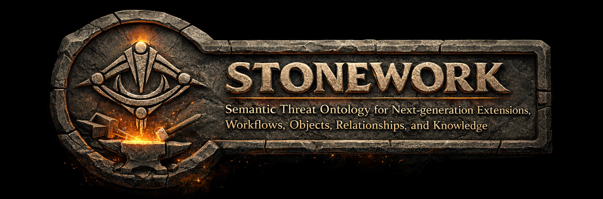

**STONEWORK** *(Semantic Threat Ontology for Next-generation Extensions, Workflows, Objects, Relationships, and Knowledge)* **is an OWL 2 cyber ontology for reasoning across threats, weaknesses, controls, assets, and evidence.**

The ontology provides a shared semantic layer for threats, weaknesses, defenses, assets, plans and their executions, hypotheses, investigations, events, observables, financial activity, and evidence-bearing relationships. It is designed to connect operational CTI, defensive engineering, cyber-physical systems, and risk/control evidence without making any single source framework the center of the model.

STONEWORK's goals are to:

- provide a lightweight core vocabulary with stable identifiers for cyber reasoning;
- align source frameworks as composable peer graphs rather than copying or replacing them;
- support cross-framework queries that connect vulnerabilities, weaknesses, attack patterns, actors, assets, events, and controls;
- keep a specification (a plan, a technique, a detection rule) distinct from a run, an observation, and the hypothesis tested against them;
- give AI-assisted analysis a typed, provenance-aware knowledge model that can be extended for local missions and data sources.

> STONEWORK is a candidate ontology for the **[Cyber Ontology Foundry](https://ncor-network.org/docs/research/cyber-ontology-foundry)**, announced at STIDS 2026.

---

## What STONEWORK covers

STONEWORK organizes cyber knowledge across linked domains that commonly appear in threat intelligence, defensive engineering, cyber-physical systems, and risk analysis:

| Domain | Sources |
|---|---|
| Adversary techniques (TTPs) | MITRE ATT&CK, CAPEC, MITRE D3FEND |
| Software weaknesses | CWE (Common Weakness Enumeration) |
| Defensive controls | NIST SP 800-53, CIS Critical Controls |
| Cyber-physical / OT assets | MITRE D3FEND PhysicalArtifact, MITRE EMB3D device properties |
| Vulnerability linkage | Connects CVE → CWE → ATT&CK technique → control |
| Event and observable alignment | OCSF, UCO, STIX/STONES |
| Financial observables | Accounts, transactions, monetary amounts, crypto assets, and laundering typologies |
| Plans, hypotheses, investigations, and qualified evidence | STONEWORK core; see below |

There is no ATT&CK for ICS adapter. Technique, mitigation, and artifact use the core classes; an ICS device is a `stonework:PhysicalArtifact` (and a `stonework:Host` when it also runs processes). `ontologies/frameworks/attack.ttl` is a draft rendering of MITRE's ATT&CK Data Model Specification v3.3.0. Its `attack:Asset` class, for ICS targets, is sketched and still open. See [`docs/attack-mapping.md`](docs/attack-mapping.md).

This coverage enables queries that no single standard can answer on its own. A SPARQL query can trace a CVE to the weakness it exploits, to the attack patterns that leverage that weakness, to the APT groups known to use them, and to the controls that mitigate the risk — in a single federated query.

Both NIST SP 800-53 and CIS Controls now carry real, materialized `stonework:mitigatesAttackPattern` links to ATT&CK — not just conceptual coverage. NIST's crosswalk is sourced from the Center for Threat-Informed Defense's mapping, since NIST's own catalog defines no ATT&CK relationship on its own.

### Plans, hypotheses, and evidence

The core keeps a specification distinct from what happened, and a claim distinct from the evidence for it. Two root classes carry that split: `stonework:CyberEntity` for persistent things (agents, infrastructure, artifacts, behaviors, intelligence products) and `stonework:CyberActivity` for what occurs (events, processes, campaigns, incidents, investigations).

A `stonework:Technique` is a method. A `stonework:Procedure` or other `stonework:Plan` is one way to carry it out, decomposed into `stonework:Step`s when that detail is worth recording. One run is a `stonework:CyberActivity` that is `stonework:executionOf` the plan; the values its `stonework:Variable`s take in that run are `stonework:VariableBinding`s. The gradient from tactic to a run is in [`docs/technique-modeling.md`](docs/technique-modeling.md). The Step, Transition, and Variable machinery is in [`docs/plan-execution-model.md`](docs/plan-execution-model.md).

A `stonework:Hypothesis` is an intelligence product: a falsifiable claim. It usually predicts a plan Variable (`stonework:predictsVariable`). An `stonework:Investigation` can also test one directly (`stonework:testsHypothesis`) without that prediction. `stonework:hasHypothesisStatus` is pending, confirmed, refuted, or superseded. A compound claim, such as "actor X is using technique Y", is a hypothesis whose `stonework:hypothesisPart` values are the separately tested claims — the activity, and the attribution. Parts are a conjunction. Alternatives are separate hypotheses linked by `stonework:competesWith`, not parts of one. That link is stated, not inferred, and confirming one does not refute the other. A warning when both rivals are confirmed. Status and confidence stay explicit; they are not inferred. Consistency requires that a compound with a refuted part is itself refuted, and that its confidence is no higher than any part's. Shapes check that each part is a hypothesis and that a hypothesis predicts at most one Variable. They do not check that consistency. `stonework:hypothesisAbout` records what the hypothesis concerns. Lineage keeps the earlier hypothesis: `splitFrom` names the one this was split from, `absorbedInto` the survivor this was merged into, and `obsoletes` the one this replaces. The earlier one is superseded unless it was already confirmed or refuted. An investigation merged into another uses `mergedInto`.

A `stonework:Campaign` is objective- and time-bounded and may be attributed to a `stonework:ThreatActor`. A `stonework:CyberActivityCluster` groups activity by analytic correlation and does not require a known actor. Activities join a cluster with `stonework:memberOfActivityCluster`. The same body of activity may be both.

An `stonework:Indicator` is the intelligence claim, including a multi-step or TTP pattern. A `stonework:DetectionRule`, and its subclass `stonework:Signature`, is the deployable check. A `stonework:Sensor` applies rules (`stonework:usesRule`) and produces `stonework:SecurityObservation`s.

A `stonework:QualifiedAssertion` records a relationship that can carry provenance, a confidence score from 0 to 100, and a validity interval (`stonework:validFrom`, `stonework:validUntil`). Provenance is optional in the baseline profile and required by the strict SHACL overlay. Source- and time-qualified metrics, including confidence history, are `stonework:MetricObservation`s. Activity parsed from a system's own record is `stonework:generatedFrom` that record. Activity established otherwise is `stonework:evidencedBy` the artifacts that show it.

An investigation tests hypotheses, collects evidence, and closes with a status and an outcome ([`docs/investigation-management.md`](docs/investigation-management.md)). A `stonework:Review` records that an analyst found a batch of records relevant or not ([`docs/record-review.md`](docs/record-review.md)). An `stonework:Opinion` (`stonework:opinionOf`) can target an intelligence product or a single qualified assertion. Who could act through an identity, and during which interval, is a `stonework:IdentityControl`. An `stonework:EmailMessage` carries its headers and sender-authentication results; a `stonework:MailboxRule` is the artifact behind mailbox-forwarding techniques.

---

## Framework composition and extensibility

STONEWORK provides its own stable namespace and core model, then composes with controlled vocabularies, source-framework alignments, and local extensions as needed. The core remains lightweight; import-only profiles add the framework mappings needed for a particular use case without forcing consumers to load every adapter.

Bundled framework modules are STONEWORK extension and alignment ontologies, not semantically self-contained replacements for the core. Each module imports STONEWORK, owns only concepts and structures specific to its source standard, and aligns shared concepts to their canonical `stonework:` terms. A module can be loaded independently in the operational sense that its declared imports provide a complete closure; it is not independent of STONEWORK's semantics.

[STONES](https://github.com/Cyber-Terrain-Ontology/stones) can be used as STONEWORK's extensible STIX 2.1 framework adapter when faithful STIX interchange is required. STONEWORK is not defined as an extension of STONES; STONES, ATT&CK, CAPEC, D3FEND, EMB3D, CWE, CVE, CPE, CVSS, NIST SP 800-53, CIS Critical Controls, the Lockheed Martin Cyber Kill Chain, OCSF, UCO, FATF, GeoSPARQL, BFO 2020, and other framework modules are peer vocabularies that can be loaded alongside STONEWORK.

STONEWORK is independent work. It is not affiliated with OASIS, MITRE, NIST, or CIS.

---

## Status

**Active development.** Core vocabulary (`ontologies/stonework.ttl`) is **0.20.0**. Controlled-vocabulary categories (`ontologies/categories.ttl`) are **0.7.0**.

The namespace (`https://cyberterrain.org/ns/stonework#`) is stable and will not change. Bundled adapters in `ontologies/frameworks/` cover ATT&CK, CAPEC, D3FEND, EMB3D, CWE, CVE, CPE, CVSS, NIST SP 800-53, CIS, the Lockheed Martin Cyber Kill Chain, BFO 2020, OCSF, UCO, FATF, GeoSPARQL, and STIX/STONES. The ATT&CK adapter is a draft rendering of MITRE's data model specification v3.3.0. The scope of coverage will grow as the ontology matures. Feedback, issues, and contributions are welcome. Release notes are in [CHANGELOG.md](CHANGELOG.md).

---

## Quick Start — Using the Ontology

### 1. Download

Choose the smallest ontology entry point that fits the use case:

```
ontologies/stonework.ttl                         # core vocabulary only
ontologies/profiles/stonework-stix.ttl           # core + categories + STIX mapping
ontologies/profiles/stonework-full.ttl           # all bundled mappings
```

STONEWORK treats STONES and other CTI framework ontologies (ATT&CK, D3FEND, CAPEC, CWE, CVE, CPE, OCSF, UCO, ...) as peer reference vocabularies. The profile ontologies declare a dependable import closure without adding vocabulary of their own. External framework datasets remain separately loadable peer graphs.

### 2. Load into a triplestore

Load the selected entry point and any external source datasets, such as `stones-merged.ttl` from the STONES repo, into an OWL-compatible triplestore:
[AllegroGraph](https://allegrograph.com) · [Stardog](https://stardog.com) · [GraphDB](https://graphdb.ontotext.com) · [Apache Jena / Fuseki](https://jena.apache.org)

### 3. Verify with SPARQL

```sparql
PREFIX stonework: <https://cyberterrain.org/ns/stonework#>
PREFIX owl:       <http://www.w3.org/2002/07/owl#>
PREFIX rdfs:      <http://www.w3.org/2000/01/rdf-schema#>

SELECT ?class ?label WHERE {
  ?class a owl:Class ;
         rdfs:label ?label .
}
ORDER BY ?label
```

### 4. Try a worked example

These examples are in the repository and exercise the plan, hypothesis, investigation, and financial vocabulary:

| Example | What it shows |
|---|---|
| [`examples/operation-plan-t1003-001.ttl`](examples/operation-plan-t1003-001.ttl) | One ATT&CK procedure as a plan, a run, and hypotheses confirmed or refuted. Walkthrough: [`docs/plan-execution-model.md`](docs/plan-execution-model.md) |
| [`examples/bec-t1114-003.ttl`](examples/bec-t1114-003.ttl) | A business-email compromise across an operation plan, a business process, detection, and an investigation. Walkthrough: [`docs/bec-worked-example.md`](docs/bec-worked-example.md) |
| [`examples/financial-follow-the-money.ttl`](examples/financial-follow-the-money.ttl) | Accounts, transactions, and laundering stages. Walkthrough: [`docs/financial-observables.md`](docs/financial-observables.md) |

The Log4Shell chain — a vulnerable product to a threat actor to a defensive control — needs the external CTI datasets (ATT&CK, CAPEC, CVE, CWE, NIST SP 800-53, CIS). Walkthrough at [cyberterrain.org](https://cyberterrain.org).

---

## Modeling convention: OWL classes and SKOS concepts

Use an OWL class for an intrinsic kind of thing whose instances should participate in class reasoning—for example, `stonework:Malware`, `stonework:ThreatActor`, or `stonework:Vulnerability`. Use a SKOS concept for a controlled vocabulary value that classifies or qualifies something—for example, `stonework:Ransomware`, a named individual of `stonework:MalwareType`. A ransomware sample is categorized by that concept; the concept is not an OWL subclass of Malware.

`stonework:categoryScheme` is the umbrella scheme for every STONEWORK category. Narrower schemes such as `stonework:malwareTypeScheme`, `stonework:incidentStatusScheme`, and `stonework:threatActorRoleScheme` organize individual vocabularies. Vocabulary values explicitly assert `rdf:type skos:Concept` plus both umbrella and vocabulary-specific `skos:inScheme` membership, so plain RDF and SKOS clients can discover them without reasoning. Matching OWL value restrictions on each category subclass keep extensions semantically consistent without treating a vocabulary class as a SKOS concept.

Every controlled-vocabulary class, scheme, and canonical value has exactly one English `skos:prefLabel` and `skos:definition`; additional languages may be supplied. Every value in a specific scheme also carries exactly one language-neutral `skos:notation`, unique within that scheme. Use the notation as the stable wire identifier and the preferred label for human-facing text.

Schemes derived from an external standard declare an IRI-valued `dcterms:source` on the scheme itself. The source records provenance; it does not assert that every STONEWORK extension is defined by, or exactly equivalent to, the cited standard.

```turtle
ex:sample-1
    a stonework:MalwareSample ;
    stonework:categorizedBy stonework:Ransomware .

stonework:Ransomware
    a stonework:MalwareType ;
    skos:notation "ransomware" .
```

### SOSA-inspired observation and actuation

STONEWORK distinguishes a persistent safeguard specification from the deployed mechanism and the activity that applies it. A `stonework:Countermeasure` describes the rule, control, or mitigation; a `stonework:SecurityActuator` is the deployed infrastructure capable of applying it; and a `stonework:SecurityActuation` records a particular application. This mirrors the SOSA actuator/actuation pattern without formally importing SOSA. Systems such as IPS and EDR platforms may be both sensors and actuators.

`stonework:Actuator` is a different class: a physical plant or process device (valve, motor, relay) that subclasses `stonework:PhysicalArtifact`. Do not conflate it with `SecurityActuator`. ICS and OT assets live under `PhysicalArtifact`; a device that also runs processes and participates in networks may additionally be typed as `stonework:Host`. EMB3D device properties, threats, and mitigations live in `ontologies/frameworks/emb3d.ttl`, not in core.

```turtle
ex:edr-agent
    a stonework:SecurityActuator ;
    stonework:implementsCountermeasure ex:isolate-host-rule .

ex:isolation-2026-08-21
    a stonework:SecurityActuation ;
    stonework:madeByActuator ex:edr-agent ;
    stonework:appliesCountermeasure ex:isolate-host-rule ;
    stonework:actsOn ex:compromised-host .
```

---

## Developer Setup

### Clone the repo

```bash
git clone https://github.com/Cyber-Terrain-Ontology/stonework.git
cd stonework
```

### Activate the pre-commit hook

Run these two commands once after cloning:

```bash
git config core.hooksPath .githooks
bash tools/download-rdf-toolkit.sh
bash tools/download-jena.sh
```

The first command activates the hooks tracked in `.githooks/`. The second downloads the [edmcouncil rdf-toolkit](https://github.com/edmcouncil/rdf-toolkit) jar (~33 MB, gitignored) used to canonicalize Turtle files on every commit. The third downloads the pinned [Apache Jena](https://jena.apache.org) 6.2.0 distribution (~24 MB, gitignored) used as the SHACL engine.

Run the ontology checks directly at any time with:

```bash
bash .githooks/format-ttl.sh --check
python3 tools/check-ontology.py
python3 tools/check-shacl.py
```

The first command verifies canonical Turtle formatting without modifying files. The second parses every Turtle file and checks high-value OWL integrity rules. The third composes the SHACL shape graphs in `ontologies/shapes/` into named validation profiles and runs them against the repository's test fixtures with the pinned [Apache Jena](https://jena.apache.org) SHACL engine. CI runs all three checks for every pull request.

The SHACL files are optional application-level data-quality profiles; they do not change STONEWORK's open-world OWL semantics and are not part of the core, STIX, or full-profile import closure. **The shapes are a validation profile, not the interoperability contract** — the contract is the ontology, and a record can be a legitimate instance of STONEWORK while still failing a shape a particular consumer cares about. Shape graphs compose: `stonework-shapes.ttl` carries source-independent value-domain rules, `frameworks/financial-shapes.ttl` carries the financial adapter contract, and `stonework-strict-shapes.ttl` adds the normalized-provenance demand on top of the core profile. Findings are tiered by `sh:severity`: `sh:Violation` means the data is malformed and gates the build, while `sh:Warning` means the data is merely incomplete (an unresolved cross-reference, a partial mapping) and is reported without failing. Shape graphs never use `sh:closed`, which the checker enforces. Existing ingest pipelines are unaffected unless they deliberately load the shapes into a SHACL-aware engine and invoke validation. See [`docs/shacl.md`](docs/shacl.md).

**What the hook does on each commit:**
- Canonicalizes all staged `.ttl` files via rdf-toolkit (alphabetical prefixes, tab indentation, consistent triple ordering) so diffs reflect content changes, not style noise
- Strips Protégé's injected default `:` prefix when present
- Parses every Turtle file and rejects common OWL integrity errors, including accidental domain/range intersections, incompatible inverse-property endpoints, property-kind collisions, class/individual punning, conflicting definitions, duplicate controlled-vocabulary labels, unresolved imports, inconsistent version metadata, and incomplete category-scheme declarations
- Sets `ontologies/catalog-v001.xml` read-only so Protégé cannot overwrite it

**Requirements:** Java 21+ and Python 3 on `PATH`. rdf-toolkit itself still runs on Java 11, but Jena 6 (the SHACL engine) requires 21.

### Ontology imports and versions

Import the stable ontology IRI, such as `https://cyberterrain.org/ns/frameworks/cve`. Each ontology also declares an `owl:versionIRI` for consumers that need to pin an exact vocabulary release. The local XML catalog resolves both forms. Every bundled framework module imports the STONEWORK core directly and declares any additional bundled dependency, so a module can be loaded independently as well as through a profile.

### Single-file merge for publication

`ontologies/stonework.ttl` (core) and `ontologies/categories.ttl` (Category/Role subclasses, SKOS concept schemes, and the controlled-vocabulary individuals) are kept separate so the core loads without the full vocabulary set. A client that dereferences the namespace IRI, however, expects every `stonework:` term in one document.

```bash
bash tools/build-merged.sh              # -> build/stonework-merged.ttl (gitignored)
```

This concatenates the two files under the core's single `owl:Ontology` header, canonicalizes with rdf-toolkit, and sanity-checks the result. The output is what gets published as `cyberterrain.org/ns/stonework.ttl`, and the WIDOCO documentation is generated from it so it covers the vocabulary individuals.

### Framework interoperability

- `ontologies/frameworks/stix.ttl` maps STONES classes and properties into STONEWORK. STIX relationship source, target, and open-vocabulary type values project through the generic qualified-assertion properties. STIX Bundle remains intentionally unmapped because it is a transport container rather than a STIX Core Object or cyber-domain assertion.
- `ontologies/frameworks/attack.ttl` maps MITRE's ATT&CK Data Model Specification v3.3.0 into STONEWORK. It is a draft. Relationships that mean the same as a STONEWORK property (uses, mitigates, detects, attributed-to, targets, revoked-by) are written as the STONEWORK property. See [`docs/attack-mapping.md`](docs/attack-mapping.md).
- `ontologies/frameworks/cve.ttl` preserves only CVE JSON-specific record structures while using STONEWORK classes and properties directly for shared vulnerability and CVSS semantics. Source-native assigner and replacement identifiers are resolved to individuals linked with `stonework:assignedBy` and `stonework:supersededBy`. A CVE `affected` entry is a `stonework:ComponentContext` linked to its canonical `stonework:VersionedProduct` with `stonework:installationOf`; a property chain projects that two-step source path into the direct `stonework:affected` relationship used by cross-framework queries.
- `ontologies/frameworks/cvss.ttl` adds decomposed vector components and additional subscores directly to the core `stonework:CvssMetric` assessment; it does not define a second metric class or duplicate the common core properties. CVSS assessments may come from NVD, CNAs, vendors, or analysts and may describe any vulnerability, not only a CVE record. Use `stonework:createdBy` for the scoring authority and `stonework:hasProvenance` for its source record.
- `ontologies/frameworks/d3fend.ttl` maps compatible MITRE D3FEND 1.5.0 defensive and offensive techniques, tactics, events, artifacts, identifiers, and selected relationships into STONEWORK. It preserves D3FEND's source-native hierarchy and class/individual punning rather than asserting equivalence. `d3f:PhysicalArtifact` subclasses `stonework:PhysicalArtifact`.
- `ontologies/frameworks/emb3d.ttl` maps MITRE EMB3D device properties, threats, and mitigations. `emb3d:DeviceProperty` subclasses `CyberEntity` as a quality of a `PhysicalArtifact`; `emb3d:hasDeviceProperty` / `emb3d:enablesThreat` / `emb3d:mitigatedBy` preserve the property → threat → mitigation graph. `mitigatedBy` is not a subproperty of `stonework:mitigates` (direction inverted).
- `ontologies/frameworks/bfo.ttl` asserts one-way BFO 2020 alignments only. `Location` maps to generically dependent continuant / information content entity (`BFO_0000031`), not Site; `PhysicalArtifact` and `Actuator` map to material entity (`BFO_0000040`).
- `ontologies/frameworks/geo.ttl` aligns `Location`, its containment and adjacency relations (`locatedWithin`, `containsLocation`, `adjacentTo`), and its coordinate and address properties with OGC GeoSPARQL 1.1, schema.org, GeoNames 3.3, and Wikidata. GeoNames parent/neighbour, schema.org `containedInPlace`/`containsPlace`, and Wikidata P150/P47 are subproperties of the STONEWORK relations; GeoSPARQL Simple Features relations, schema.org `geoWithin`/`geoTouches`, and Wikidata P131 are `skos:closeMatch` only, because they also relate geometries or non-place subjects. GeoNames, Wikidata, or schema.org place IRIs can be typed `stonework:Location` directly, and GeoSPARQL `geo:hasGeometry` can attach shapes to a `Location`.
- `ontologies/frameworks/ocsf.ttl` maps the complete OCSF 1.9.0 core event taxonomy into `stonework:Event`, retaining OCSF category and class identifiers for round-tripping.
- `ontologies/frameworks/uco.ttl` maps compatible UCO 1.5.0 action, identity, location, and observable classes into STONEWORK. It remains class-only because UCO places observable values on facet nodes while STONEWORK commonly projects them directly onto domain entities.
- `ontologies/frameworks/fatf.ttl` supplies a starter set of money-laundering typology individuals drawn from FATF methods-and-trends guidance, mapped into the neutral `stonework:IllicitFinanceTechnique` and `stonework:LaunderingStage` slots that the core defines. It is an illustrative, non-exhaustive, non-normative convenience — not a reproduction of FATF guidance — and other bodies' typology sets can populate the same slots.

These adapters are alignment modules rather than copies of their source standards. Load the official D3FEND ontology, EMB3D catalog, OCSF schema, UCO ontologies, GeoSPARQL, GeoNames, or BFO 2020 alongside STONEWORK when source-native constraints and attributes are required. Type ICS assets as `PhysicalArtifact` (and `Host` when they also run processes).

### CVSS assessments and plan variables

Use `stonework:cvssBaseScore`, `stonework:cvssSeverity`, and `stonework:cvssVector` directly on a `stonework:Vulnerability` for one selected headline score. Use `stonework:CvssMetric` through `stonework:hasCvssMetric` when version, scoring authority, provenance, or multiple assessments must be retained. The CVSS framework module adds decomposed vector fields but is not required for the common structured fields. CVSS base metrics express context-neutral technical severity. Environmental metrics may adjust technical severity for a deployment context, but CVSS alone does not establish that the product is present or express full enterprise risk.

A `stonework:Variable` is not another CVSS representation. It is an execution-time placeholder used when a Plan consumes an existing score or an Investigation calculates a new assessment. An enterprise assessment may consider a `stonework:Vulnerability`, its `stonework:CvssMetric`, and current infrastructure state; the executing `stonework:Investigation` constructs a contextual `stonework:VulnerabilityAssessment` and binds an output Variable to it.

Values that change over time or differ by source — an EPSS probability and its percentile, a report that a vulnerability was exploited, exploit maturity, known-exploited catalog membership — are `stonework:MetricObservation`s. The catalog or scoring source is `stonework:hasProvenance`, not a separate metric type. Direct datatype properties remain convenience projections for a single current value.

### Financial observables

STONEWORK models financial accounts, transactions, and "follow the money" links that STIX 2.1 does not define. `stonework:FinancialAccount` (a value-holding sibling of `stonework:UserAccount` under `stonework:Account`) is defined by function — it covers a bank account, an exchange-hosted or self-custody crypto wallet, a prepaid card, or a merchant stored-value balance — with the holding institution recorded on the optional `stonework:heldAt` link. `stonework:FinancialTransaction` is an occurrent under `stonework:CyberActivity` carrying originator, beneficiary, and intermediary accounts, a reified `stonework:MonetaryAmount`, and a `stonework:fundsActivity` link to the campaign or incident it finances. `stonework:CryptoAsset` is re-grounded as a unit of value (`rdfs:subClassOf stonework:Currency`); wallets are `stonework:FinancialAccount` individuals and their addresses are `stonework:CryptoAddress` identifiers. See `examples/financial-follow-the-money.ttl` and [`docs/financial-observables.md`](docs/financial-observables.md).

### Names and aliases

We recommend using `skos:prefLabel` for an entity's preferred human-readable name and repeat `skos:altLabel` for alternative names, pseudonyms, or spellings. `skos:altLabel` is intentionally not restricted to `stonework:Agent`: threat actors, malware, campaigns, tools, products, infrastructure, and other resources may all have alternate labels. Model a persona or account with its own identifiers and activity as a `stonework:DigitalIdentity`, not as a label.

---

## Documentation

| Resource | URL |
|---|---|
| Website | [cyberterrain.org](https://cyberterrain.org) |
| Ontology reference (WIDOCO) | [cyberterrain.org/ns/stonework/doc](https://cyberterrain.org/ns/stonework/doc/) |
| Namespace | `https://cyberterrain.org/ns/stonework#` |
| STIX adapter | [STONES](https://github.com/Cyber-Terrain-Ontology/stones) |
| Release notes | [CHANGELOG.md](CHANGELOG.md) |
| Plans and executions | [`docs/plan-execution-model.md`](docs/plan-execution-model.md) |
| Technique gradient | [`docs/technique-modeling.md`](docs/technique-modeling.md) |
| ATT&CK mapping | [`docs/attack-mapping.md`](docs/attack-mapping.md) |
| Investigations | [`docs/investigation-management.md`](docs/investigation-management.md) |
| Record review | [`docs/record-review.md`](docs/record-review.md) |
| Financial observables | [`docs/financial-observables.md`](docs/financial-observables.md) |
| BEC worked example | [`docs/bec-worked-example.md`](docs/bec-worked-example.md) |
| SHACL profiles | [`docs/shacl.md`](docs/shacl.md) |

---

## Ecosystem

STONEWORK is the broad ontology in the Cyber Terrain Ontology ecosystem. It can compose with STONES when STIX 2.1 fidelity or interchange is needed:

- **STONEWORK** — independent ontology for threats, weaknesses, controls, assets, plans, hypotheses, investigations, and cross-framework reasoning *(this repository)*
- **STONES** — faithful OWL 2 binding of STIX 2.1, usable as an extensible STIX framework adapter for STONEWORK

Both ontologies are candidate submissions to the **Cyber Ontology Foundry**, alongside MITRE's [D3FEND Framework Ontology](https://github.com/d3fend/d3fend-ontology).

---

## Adopters

*Using STONEWORK in a project or product? Open an issue or pull request to be listed here.*

---

## License

STONEWORK is released under the **MIT License** — free to use, extend, and integrate in both open-source and commercial environments. See [LICENSE](LICENSE) for full terms.
